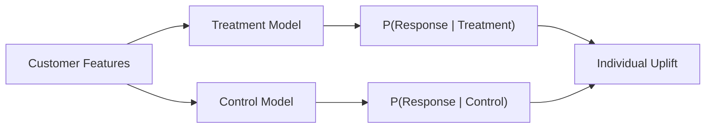
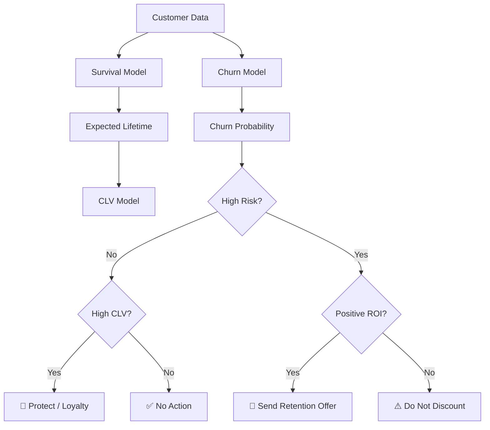
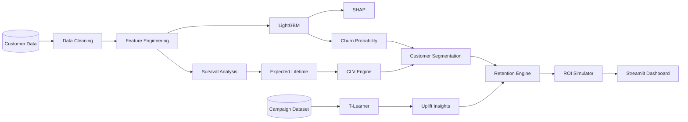

<div align="center">

# 📊 Customer Lifetime Value & Churn Intelligence System

### Predict Churn • Explain Risk • Estimate CLV • Target Retention • Optimize ROI

[](https://www.python.org/)
[](https://lightgbm.readthedocs.io/)
[](YOUR_STREAMLIT_APP_URL)
[](https://github.com/Poonam4385/Capstone-and-Industry-Project-DS-01)

<br>

## 🚀 LIVE INTERACTIVE DASHBOARD

### [▶️ OPEN CUSTOMER INTELLIGENCE DASHBOARD](YOUR_STREAMLIT_APP_URL)

</div>

---

## 📌 Executive Dashboard

<table>
<tr>
<td align="center">

### 👥 7,043  
**Customers**

</td>

<td align="center">

### ⚠️ AI Powered  
**Churn Risk**

</td>

<td align="center">

### 💰 CLV  
**Customer Value**

</td>

<td align="center">

### 🎯 Uplift  
**Retention Targeting**

</td>

<td align="center">

### 📈 ROI  
**Campaign Optimization**

</td>
</tr>
</table>

---

## 🧭 Dashboard Navigation

| Dashboard | Purpose |
|---|---|
| 🏠 **Executive Dashboard** | Portfolio-level customer KPIs |
| 👤 **Customer Explorer** | Investigate individual customer risk and value |
| ⚠️ **Churn Intelligence** | Predict customers likely to leave |
| 🔍 **SHAP Explainability** | Understand why customers are predicted to churn |
| ⏳ **Survival Analysis** | Estimate how long customers may remain |
| 💰 **Customer Lifetime Value** | Estimate economic customer value |
| 🎯 **Retention Targeting** | Identify customers worth targeting |
| 🧪 **Uplift Modeling** | Estimate incremental treatment response |
| 📈 **ROI Simulator** | Test campaign economics interactively |

---

# 🎯 Model Performance Dashboard

| Metric | Optimized LightGBM |
|---|---:|
| **ROC-AUC** | 🟢 **0.848** |
| **PR-AUC** | 🟢 **0.663** |
| **Recall** | 🟢 **80.48%** |
| **Precision** | **51.28%** |
| **F1 Score** | **62.64%** |

### Model Objective

The system prioritizes **recall** because failing to identify a customer who actually churns can be more expensive than contacting some customers who ultimately stay.

---

<details>
<summary><b>🔍 Click to explore SHAP Explainability</b></summary>

<br>

SHAP explains both global and individual churn predictions.

### Major Churn Drivers

- Short customer tenure
- Month-to-month contract
- Absence of long-term contract
- Electronic check payment
- High monthly charges
- Fiber-optic internet
- Lack of technical support
- Lack of security services

### Example

A customer may receive:

```text
Predicted Churn Probability = 95.42%
```

Instead of giving only the probability, SHAP explains the prediction:

```text
Short Tenure                ↑ Churn Risk
Month-to-Month Contract     ↑ Churn Risk
Electronic Check            ↑ Churn Risk
No Tech Support             ↑ Churn Risk
Fiber Optic Internet        ↑ Churn Risk
```

</details>

---

<details>
<summary><b>⏳ Click to explore Survival Analysis</b></summary>

<br>

Customer survival behavior is modeled using:

- Kaplan-Meier estimator
- Log-rank testing
- Cox Proportional Hazards model
- Customer-level survival curves
- Expected lifetime estimation

### Business Question

> How long is this customer expected to remain with the company?

The predicted survival information feeds directly into the CLV calculation.

</details>

---

<details>
<summary><b>💰 Click to explore Customer Lifetime Value</b></summary>

<br>

Customer Lifetime Value combines:

```text
Monthly Revenue
      ×
Expected Margin
      ×
Expected Customer Lifetime
      ×
Discount Factor
```

Customers are grouped into:

| CLV Segment | Business Meaning |
|---|---|
| 🟢 Very High | Strategic customers |
| 🔵 High | Valuable customers |
| 🟡 Medium | Moderate value |
| ⚪ Low | Lower economic value |

This allows retention decisions to consider **value as well as churn risk**.

</details>

---

# 🎯 Customer Decision Matrix

| | 💰 Low CLV | 💰 High CLV |
|---|---|---|
| **⚠️ High Churn Risk** | Low-cost retention | 🔥 **Priority Retention** |
| **✅ Low Churn Risk** | Minimal action | 💎 **Protect / Loyalty** |

### Retention Segments

#### 🔥 High-Value At-Risk
High CLV + high churn probability.

**Action:** Priority retention intervention.

#### 💎 High-Value Loyal
High value + lower churn risk.

**Action:** Loyalty protection.

#### ⚠️ Low-Value At-Risk
High churn probability + low CLV.

**Action:** Low-cost intervention only.

#### ✅ Low-Value Stable
Low churn probability + lower CLV.

**Action:** Minimal intervention.

---

# 🧪 Uplift Modeling Dashboard

The uplift module estimates whether treatment actually changes customer behavior.

A Python 3.13-compatible **T-Learner** was implemented using two LightGBM models:



### Predicted Treatment Effect

```text
Uplift
=
P(Response | Treatment)
-
P(Response | Control)
```

---

## 📊 Uplift Targeting Results

| Targeted Population | Observed Uplift |
|---:|---:|
| 🥇 **Top 10%** | **3.505%** |
| Top 20% | 1.849% |
| Top 30% | 1.234% |
| Top 40% | 0.945% |
| Top 50% | 0.767% |

### 🔥 Key Finding

The **top 10% ranked customers** generated the strongest treatment response.

This demonstrates why targeting everyone is inefficient.

---

# 💸 Interactive Retention ROI Simulator

### 🚀 [OPEN ROI SIMULATOR](YOUR_STREAMLIT_APP_URL)

The live dashboard lets business users change:

```text
Discount Offered          1% ─────────────── 30%

Offer Duration            1 ──────────────── 12 months

Expected Retention
Uplift                     1% ─────────────── 30%

Target Population          5% ─────────────── 50%
```

and immediately calculates:

<table>
<tr>

<td align="center">

### 👥
**Customers Targeted**

</td>

<td align="center">

### 💵
**Campaign Cost**

</td>

<td align="center">

### 💰
**Expected Value**

</td>

<td align="center">

### 📊
**Net Benefit**

</td>

<td align="center">

### 📈
**ROI**

</td>

</tr>
</table>

---

# 📈 Break-Even Dashboard

### Top 10% Highest-Risk Customers

| Discount | Customers | Campaign Cost | Required Retention Uplift |
|---:|---:|---:|---:|
| **5%** | 709 | $8,644.60 | 🟢 **5.42%** |
| **10%** | 709 | $17,289.19 | **10.84%** |
| **15%** | 709 | $25,933.79 | **16.26%** |
| **20%** | 709 | $34,578.39 | **21.68%** |
| **25%** | 709 | $43,222.99 | 🔴 **27.09%** |

### Business Interpretation

A 5% discount requires only approximately **5.42% incremental retention uplift** to break even.

A 25% discount would require more than **27% incremental retention uplift**.

Therefore:

> **Smaller targeted offers are considerably easier to justify economically than large blanket discounts.**

---

# 🧠 Intelligent Retention Decision Engine



---

# 🏗 End-to-End System Architecture



---

# 🛠 Technology Stack

<table>
<tr>
<td><b>Data</b></td>
<td>Pandas • NumPy</td>
</tr>

<tr>
<td><b>Machine Learning</b></td>
<td>LightGBM • Scikit-learn</td>
</tr>

<tr>
<td><b>Optimization</b></td>
<td>Optuna</td>
</tr>

<tr>
<td><b>Explainability</b></td>
<td>SHAP</td>
</tr>

<tr>
<td><b>Survival Analysis</b></td>
<td>Lifelines</td>
</tr>

<tr>
<td><b>Uplift Modeling</b></td>
<td>T-Learner • LightGBM</td>
</tr>

<tr>
<td><b>Visualization</b></td>
<td>Plotly • Matplotlib</td>
</tr>

<tr>
<td><b>Dashboard</b></td>
<td>Streamlit</td>
</tr>

<tr>
<td><b>Database</b></td>
<td>PostgreSQL</td>
</tr>

<tr>
<td><b>Development</b></td>
<td>VS Code • Jupyter</td>
</tr>
</table>

---

# 📂 Project Structure

```text
Capstone-and-Industry-Project-DS-01/
│
├── 📊 app.py
│
├── 📁 customer_intelligence_final.csv
│
├── 🤖 optimized_lightgbm_churn.pkl
│
├── ⚙️ churn_preprocessor.pkl
│
├── 📦 requirements.txt
│
├── 📖 README.md
│
├── 📓 Customer_Lifetime_Value_and_Churn_Intelligence_System.ipynb
│
└── 📁 images/
    ├── executive_dashboard.png
    ├── churn_dashboard.png
    ├── clv_dashboard.png
    └── roi_simulator.png
```

---

# 🖥️ Dashboard Preview

Add your Streamlit screenshots to an `images` folder and GitHub will display them here.

### Executive Dashboard

```markdown

```

### Churn Intelligence

```markdown

```

### CLV Analytics

```markdown

```

### ROI Simulator

```markdown

```

---

# ▶️ Run Locally

### 1. Clone

```bash
git clone https://github.com/Poonam4385/Capstone-and-Industry-Project-DS-01.git
```

### 2. Enter project folder

```bash
cd Capstone-and-Industry-Project-DS-01
```

### 3. Install dependencies

```bash
pip install -r requirements.txt
```

### 4. Launch dashboard

```bash
python -m streamlit run app.py
```

### 5. Open

```text
http://localhost:8501
```

---

# 📦 Dataset Strategy

<details>

<summary><b>IBM Telco Customer Churn</b></summary>

Used for:

- Feature engineering
- Churn prediction
- SHAP explanations
- Survival analysis
- CLV
- Customer segmentation
- Retention decision system

</details>

<details>

<summary><b>Criteo Uplift Dataset</b></summary>

Used separately for:

- Treatment/control modeling
- T-Learner development
- Individual uplift estimation
- Uplift deciles
- Qini analysis
- Campaign targeting evaluation

The datasets are intentionally **not merged at customer level** because they represent different populations.

</details>

---

# 💡 Core Business Insight

Traditional churn modeling asks:

> **Who will leave?**

This system goes further:

> **Who will leave?**

> **Who matters financially?**

> **Who can actually be influenced?**

> **What intervention is economically worthwhile?**

---

<div align="center">

# Predict → Explain → Value → Target → Optimize → Act

### 🚀 [Launch Interactive Dashboard](YOUR_STREAMLIT_APP_URL)

<br>

### Repository

https://github.com/Poonam4385/Capstone-and-Industry-Project-DS-01

<br>

⭐ **If you find this project useful, consider starring the repository.**

</div>
